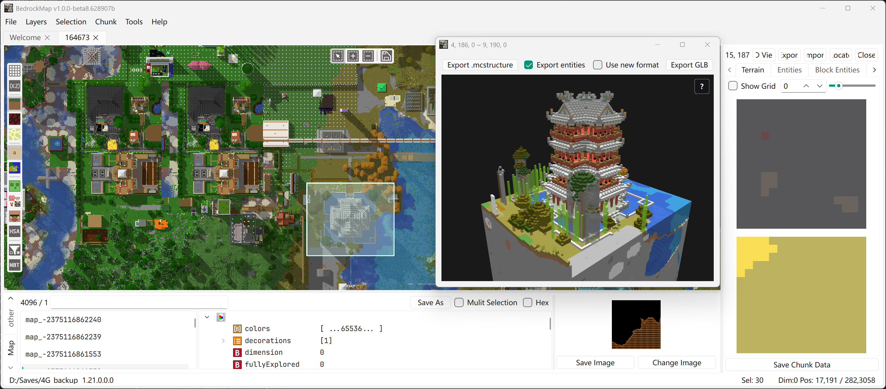

<p align="center">
  
</p>

# BedrockMap

<p align="center">
  
  
</p>

**English** | [简体中文](./README.zh-CN.md)

**BedrockMap** is a fully open-source map editor for Minecraft Bedrock Edition, built with Qt 6, Qt Quick, and C++20. It provides tools for browsing, inspecting, and editing Bedrock world saves (LevelDB format) across dimensions.

## Features

- **World Browsing** — Open and explore Bedrock worlds across the Overworld, Nether, and The End, plus custom dimensions
- **Terrain Visualization** — Biome maps and terrain overlays with configurable rendering filters
- **Chunk Editor** — Select, inspect, and delete chunks; visualize chunk entities, block entities and pending ticks
- **Chunk Copy & Paste** — Copy selected regions and paste them into other worlds, even across different saves, with interactive placement
- **NBT Editor** — View and modify NBT data including `level.dat`, player inventories, villages, map items, and more
- **mcstructure Support** — Browse and edit `.mcstructure` files with a 3D voxel preview, and export selected regions or chunks as `.mcstructure` files
- **Voxel Rendering** — 3D voxel visualization of selected regions, exportable as GLB models
- **Multiple Sessions** — Open and manage multiple worlds simultaneously

## Download

Grab the latest release from the [Releases page](https://github.com/bedrock-dev/BedrockMap/releases).

## System Requirements

- **OS** — Windows 10 or newer; Android builds are also supported

## Quick Start

Open a world from the world list, or drag and drop a world folder or `.mcstructure` file onto the application. The map supports panning, zooming, selection, and a context menu.

## Build

```powershell
# Clone with submodules
git clone --recursive https://github.com/bedrock-dev/BedrockMap.git

# Build the Qt Quick application
.\scripts\build.ps1

# Run it
.\scripts\run.ps1
```

## Supported MCBE Versions

Worlds from Minecraft Bedrock 1.2 (and possibly earlier) are supported, up to the 1.21 series (the chunk format varies by version).

## Contributing

Bug reports and feature requests are welcome via [Issues](https://github.com/bedrock-dev/BedrockMap/issues). See [TODO.md](./TODO.md) for planned features and known issues.

## License

BedrockMap is licensed under the [GNU Affero General Public License v3.0](./LICENSE).

## Credits

- [bedrock level](https://github.com/bedrock-dev/bedrock-level) for the software backend
- [Minecraft Wiki](https://minecraft.wiki/) for mob, NBT, and block entity icons
